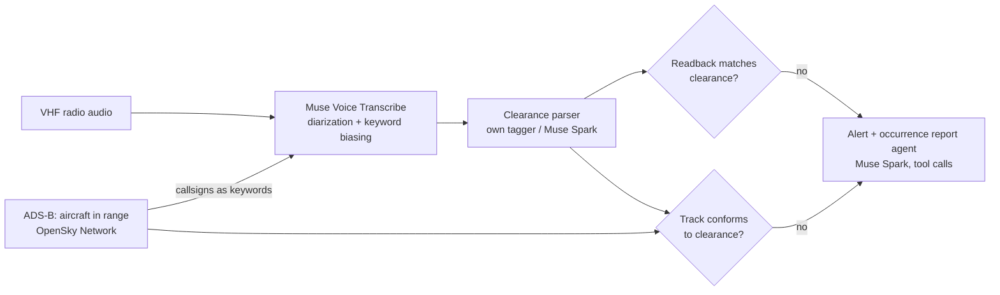

# Readback

A controller says "CSA1DZ, descend flight level one hundred". The pilot replies "descending flight level one one zero, CSA1DZ". Nobody notices. That missed **readback error** is a classic cause of altitude busts and loss of separation.

Readback listens to the radio frequency, works out what each aircraft was cleared to do, checks the pilot's readback against it, and then checks the aircraft's actual track (ADS-B) against the clearance. When something doesn't match it raises an alert with the audio clip and the flight track attached, and an agent can draft the occurrence report.

It runs three ways: on a live frequency with ADS-B, on a recording dropped into the browser (post-incident review, training, quality assurance), and as a replay of simulated traffic with planted errors.

Built for the [Meta Global AI Developer Hackathon](https://cerebralvalley.ai/e/meta-ai-developer-hackathon) (Oct 26 – Nov 4, 2026), Indie track, "Push the Frontier" theme.

## How it works



- **Hearing the radio.** Each push-to-talk transmission goes to Muse Voice Transcribe on its own, and its keyword biasing gets the callsigns of aircraft that ADS-B says are actually nearby. Callsigns are the hardest part of ATC speech to recognize and the most important to get right.
- **Understanding clearances.** Each turn becomes a structured clearance: callsign, instruction, altitude, heading, speed, frequency, runway, squawk.
- **Two checks.** The readback against the clearance, and the aircraft's ADS-B track against the clearance (for example, cleared to FL100 but still descending through it).
- **Explaining what happened.** For any alert, a Muse Spark agent pulls the transmissions, ADS-B track and other alerts it needs through tool calls and drafts a structured occurrence report.
- **On-premises parsing.** Air navigation providers are wary of sending radio content to a cloud service. Readback's own tagger parses clearances on a CPU, with no network; `scripts/export_sft.py` also writes fine-tuning data for Muse Glimmer (open weights).

## Status

| Date | Work |
|---|---|
| Oct 27 | Project scaffold. Voice Transcribe client, ATC text normalizer, recognition metrics, and the day-1 go/no-go test of Voice Transcribe on real ATC radio. |
| Oct 27 | Clearance schema, rule-based clearance parser, readback comparator, Muse Spark parser (structured output), and a text-level evaluation on 432 real controller/pilot exchanges: 98.4% of planted readback errors caught at about 98% precision. |
| Oct 27 | ADS-B conformance checks (level bust, wrong direction, level-off short, heading, squawk), the live frequency monitor, a simulated Bengaluru approach with planted errors and VHF-style radio audio, and a radar-scope web UI with replay and live OpenSky traffic. |
| Oct 27 | Readback's own clearance parser: a small neural tagger that trains itself continuously on a four-level synthetic curriculum, is tested on 287 hand-labeled real transmissions, and reports to a live training dashboard and [`TRAINING.md`](TRAINING.md). |
| Oct 27 | A blind real-radio test for the tagger on ATCO2 (seven airports). Set 1 showed the tagger had overfit to Prague; generator v3 widened the phraseology, and a fresh set 2 now measures it. |
| Oct 28 | First live Meta API runs. The Voice Transcribe go/no-go on 300 real-radio transcriptions came back CAUTION: digits pass, callsigns don't. Muse Spark was scored as a parser. Voice Transcribe and Spark now run live in the radar UI. Heard callsigns are matched to ADS-B, and the recognizer's stutters are dropped. On transcribed radio audio, the monitor catches all 68 planted problems. |
| Oct 29 | Recordings: drop any audio file in the browser, and it is cut into transmissions at the silences, transcribed and checked. On a real Prague recording it catches a squawk read back as 1402 instead of 1404. Occurrence-report agent (Muse Spark with tool calls). Speaker roles from what is said ("ready for", "request") and from who was just addressed; a misheard callsign recovered from the flight number. Spark and the tagger scored on the blind set. Docker image, built and smoke-tested in CI. |

Everything in this repository was written during the hackathon.

## Setup

Requires Python 3.12+ and [uv](https://docs.astral.sh/uv/). ffmpeg is needed for recordings in formats other than WAV.

```bash
uv sync
cp .env.example .env   # then add your Meta Model API key
uv run readback-ui     # http://127.0.0.1:8000
uv run python scripts/fetch_data.py   # only for the evaluations
```

Or with Docker (ffmpeg, espeak-ng and the CPU tagger included):

```bash
docker build -t readback .
docker run -p 8000:8000 --env-file .env readback
```

| Variable | Default | |
|---|---|---|
| `MODEL_API_KEY` | (none) | Meta Model API key. Without it, scenarios replay from the script with the tagger or rules; Voice Transcribe, Spark, recordings and reports are off. |
| `READBACK_PARSER` | `tagger` | `rules` to use the rule-based parser in the monitor. |
| `READBACK_HOST` | `127.0.0.1` (`0.0.0.0` in Docker) | Address the server listens on. |
| `READBACK_PORT` | `8000` | Port. |

`GET /healthz` reports the parser in use and whether the Muse models are available.

## Day-1 go/no-go test

Before building anything on top, we measure how well Voice Transcribe hears real ATC radio, with and without callsign biasing:

```bash
uv run python scripts/spike_asr.py --dry-run   # checks the pipeline, no API calls
uv run python scripts/spike_asr.py             # 100 clips x 3 keyword conditions
```

The report goes to [`results/spike-asr.md`](results/spike-asr.md). It scores word error rate, digit error rate (altitudes, headings, frequencies) and callsign accuracy. Recognizer output and references are compared in a canonical form, so `CSA1DZ descend FL100` matches `csa one delta zulu descend flight level one hundred`.

Result on 60 ATCO2 and 40 UWB-ATCC clips (real VHF radio), with each condition's keyword list:

| ATCO2 keywords | WER | Digit error | Callsign accuracy | Verdict |
|---|---|---|---|---|
| none | 44.4% | 32.6% | 6.7% | NO-GO |
| ICAO phraseology | 31.0% | 22.2% | 13.3% | NO-GO |
| phraseology + ADS-B callsigns in range | **25.3%** | **17.4%** | **56.7%** | **CAUTION** |

Keyword biasing is what makes Voice Transcribe usable on ATC radio. Giving it the callsigns ADS-B says are nearby takes callsign accuracy from 7% to 57%, and digit error is inside the GO bar (25%). Callsigns are still below the GO bar (70%), so the monitor doesn't trust a heard callsign on its own (see [Listening to the radio](#listening-to-the-radio)). Two things we learned along the way:

- The API rejects keywords longer than 30 characters, and most spoken callsigns are longer ("air portugal nine three one charlie"). `keywords.fit` cuts them at a word boundary.
- Voice Transcribe sometimes repeats a word or two where a phrase ends ("heading two two five, five", "flight level flight level"). `asr.drop_repeats` removes those, but never repeated digits with no break between them, because "one one zero" is a real level. On the same real-radio transcripts it lowers WER in every condition (ATCO2 with ADS-B keywords: 25.3% → 23.7%) and never raises digit error ([`results/spike-asr-drop-repeats.md`](results/spike-asr-drop-repeats.md)).

## Readback error detection

Each transmission is parsed into a structured clearance (callsign plus items such as `flight_level 100`, `heading 240 left`, `frequency 119.605`, `cleared_to_land 27l`), and the pilot's readback is compared with the controller's instruction. A wrong value or callsign is an error. An omitted item is a warning, because pilots legitimately shorten readbacks.

There are three parsers: a fast rule-based one for standard ICAO phraseology (`src/readback/rules.py`), Readback's own trained tagger ([below](#a-parser-that-trains-itself)), and Muse Spark with a strict JSON schema (`src/readback/llm.py`).

```bash
uv run python scripts/eval_readback.py                  # rule-based parser
uv run python scripts/eval_readback.py --parser both    # also Muse Spark (needs the API key)
```

The evaluation pairs each controller instruction in UWB-ATCC with the pilot's reply, then plants one readback error per pair by changing a digit the pilot echoed (flight level, heading, squawk, frequency, runway) or a character of the callsign. Those are errors by construction, so recall is exact. Results: [`results/readback-eval.md`](results/readback-eval.md).

| Parser | Real pairs | Flagged | Planted errors | Recall | Precision (approx.) |
|---|---|---|---|---|---|
| Rule-based | 441 | 2.0% | 311 | 98.4% | 98.1% |
| Tagger (round 248) | 441 | 9.3% | 311 | 98.4% | 94.4% |
| Muse Spark | 441 | 16.8% | 311 | **99.4%** | 89.8% |

These pairs are from Prague, the phraseology the rules were written for, and they were mined with the rule-based callsign matcher, which flatters the rules here. On radio the rules weren't written for, they fall apart. On hand-labeled transmissions ([`results/parser-eval.md`](results/parser-eval.md), reference transcripts):

| Test set | Parser | Exact | Item F1 | Callsign |
|---|---|---|---|---|
| Prague (UWB-ATCC), held-out half (138) | rule-based | 67.4% | 87.4% | 76.8% |
| | tagger | **90.6%** | **97.2%** | 94.2% |
| | Muse Spark | 87.7% | 95.7% | 94.2% |
| **ATCO2 set 2, blind**, seven airports (263) | rule-based | 34.6% | 86.6% | 35.7% |
| | tagger | 80.2% | **91.7%** | 86.3% |
| | Muse Spark | **85.9%** | 91.2% | **95.1%** |

*Exact* means the callsign and every item are right. Spark is best on callsigns it has never seen. The tagger is as good on clearance items, runs offline on a CPU in milliseconds, and raises fewer false alarms. The UI lets you pick either.

Several of the flagged real pairs look like genuine readback errors in the recordings: for example, runway 31 read back as 13, and squawk 1404 read back as 1402.

## Live monitor and radar scope

`readback.monitor` follows a frequency turn by turn. It pairs each pilot reply with the open instruction for that callsign and raises readback alerts: wrong value, omitted item, a reply from a similar-sounding callsign, or no reply within 20 seconds. Once a clearance is read back, it watches the aircraft's ADS-B track (`readback.adsb`). It flags a bust of the cleared level by more than 300 ft, a climb when the clearance was to descend, levelling off short, a heading more than 20° off after the turn, and the wrong squawk.

```bash
uv run readback-ui    # then open http://127.0.0.1:8000
```

The **Scenario** tab replays a simulated Bengaluru (VOBL) approach frequency through the monitor in real time: radar scope, radio log with the parsed clearance under each transmission, and alerts as they fire. The **Live BLR traffic** tab shows real aircraft around Bengaluru from the OpenSky Network.

Scenarios come from `readback.sim`. Five aircraft get descents, turns, speed changes, frequency changes and squawks. Each fleet includes two callsigns with the same digits swapped, and the simulator plants readback errors, callsign confusions, omitted items, unanswered calls and track deviations. `scripts/make_scenarios.py --audio` also renders each transmission as speech (Windows voices, or espeak-ng on Linux) passed through a VHF radio effect, for the Voice Transcribe path.

On 200 scenarios (5,220 transmissions), the monitor with the rule-based parser caught all 2,052 planted problems, and none of its 1,351 error-level alerts were false. Details: [`results/scenario-eval.md`](results/scenario-eval.md). The scenarios use clean standard phraseology, so this checks the monitor's logic end to end. It is not a measure of accuracy on real radio.

```bash
uv run python scripts/eval_scenarios.py --scenarios 200
```

### Listening to the radio

In the Scenario tab, set **Speech** to *Voice Transcribe*, and each transmission's radio audio is sent to Muse Voice Transcribe as the replay reaches it. The keywords are the callsigns ADS-B shows in range. The transcript then goes to the chosen **Parser**: the tagger, Muse Spark, or the rules. The radio log shows what was heard, what was actually said when the two differ, and how long Voice Transcribe and the parser took. This needs `MODEL_API_KEY` in `.env`. Without it, the UI falls back to the script.

Three safeguards come from what speech recognition gets wrong:

- **Callsigns are matched to ADS-B.** A heard callsign that isn't on ADS-B becomes the aircraft it most likely is: the only one in range that matches it, or that is one word away ("ifly seven eight four" when only IFLY785 is nearby). If two aircraft fit, it stays as heard. A pilot who answers with another aircraft's real callsign still matches that aircraft, so callsign confusion is still caught. The radio log marks every match.
- **Stutters are dropped** (`asr.drop_repeats`, above).
- **Impossible instructions are ignored.** An instruction no controller could give (FL2770, squawk 7248) is treated as a mishearing and not checked. The same value in a pilot's readback is still an error.
- **Who is talking is inferred from what is said.** Controllers open with the callsign and pilots usually close with it, but a call asking for something ("ready for departure", "request descent") is the pilot's, and so is a transmission naming the aircraft that was just given an instruction. A callsign misheard beyond matching is recovered from the flight number when exactly one aircraft has it ("one one zero two, cleared ...").

`eval_scenarios.py --audio` measures the whole chain on 6 scenarios (146 transmissions). Each transmission is spoken, radio-filtered, transcribed by Voice Transcribe, parsed by the rule-based parser, and run through the monitor ([`results/scenario-audio-eval.md`](results/scenario-audio-eval.md)):

| | From the script | From the audio |
|---|---|---|
| Planted problems caught | 68 / 68 | **68 / 68** |
| Error alerts that matched no planted problem | 0 of 45 | 14 of 59 (precision 76%) |

Word error rate on this audio was 1.6%, with a median of 2.0 s per transmission. Before ADS-B matching and stutter removal, the same transcripts gave 58 of 68 caught at 56% precision. Most remaining false alarms come from a digit Voice Transcribe repeated inside a number ("one six six zero" for "one six zero"). That can't safely be told apart from a real readback error. Synthetic voices are cleaner than real radio, so this shows the chain working, not real-world accuracy.

```bash
uv run python scripts/eval_scenarios.py --audio    # Windows; about 150 Voice Transcribe calls, cached
```

## Checking a recording

The **Recording** tab takes any audio file: a recorder export, a LiveATC archive, a phone recording of a scanner (WAV directly, other formats through ffmpeg, up to 10 minutes). It is cut into transmissions at the silences between them, each is transcribed by Voice Transcribe, and the monitor pairs and checks them as it would live. Callsigns known to be on frequency can be given, in ADS-B form (`SWR123`) or spoken, and are used as keywords and for matching. The result is the radio log, alerts and an audio player. The same check is an API call:

```bash
curl -X POST --data-binary @frequency.wav "http://127.0.0.1:8000/api/analyze?callsigns=SWR123,DLH4CK&parser=tagger"
```

Tested on a 43-second real recording from Prague (UWB-ATCC) in which a pilot reads back squawk 1404 as 1402. Voice Transcribe's output differed from run to run on this accented radio. Of seven runs, three gave the exact alert ("read back squawk 1402, cleared squawk 1404"), two flagged the same squawk as not read back, and two blamed a wrong callsign after the recognizer dropped the word "squawk". So on real radio the error is flagged every time, but not always cleanly.

## Occurrence reports

Every alert has a **Draft occurrence report** button. A Muse Spark agent (`readback.occurrence`) gets the alert and four tools: `transmissions` (filtered by callsign and time), `adsb_track` (sampled every 10 s), `alerts`, and `submit_report`. It decides what evidence to pull, then files a report against a strict schema: title, occurrence type, risk, summary, timeline, contributing factors, recommended actions, and a statement of evidence quality. The report lists the tool calls it made and downloads as Markdown. On the Prague recording above it made eight tool calls in 31 s and noted that the evidence came from speech recognition, with no ADS-B. It is a draft for a safety officer to review, not a filed report.

## How it compares

| | Readback | HAAWAII (SESAR research project) | Open-source readback checkers on GitHub |
|---|---|---|---|
| Input | Live frequency with ADS-B, recordings, simulated traffic | Recorded operations audio | Mostly audio files or batches (Whisper plus an LLM, or a knowledge graph) |
| Checks | Readback values, callsign confusion, omissions, unanswered calls, **and the aircraft's ADS-B track against the clearance** | Readback errors | Readback errors |
| Published accuracy | Rules: 98.4% recall at ~98% precision on 311 planted errors. Tagger: 91.7% item F1 on a blind seven-airport set | 81% of readback errors detected at an 11% false-alarm rate, on real operations audio | Mostly none; one reports 66-78% fact precision |
| After an alert | Agent-drafted occurrence report with its evidence | Not in scope | Not in scope |
| Runs as | One command or a Docker image; the parser works offline on a CPU | Research prototype | Scripts or notebooks |

The numbers come from different data and setups, so they are not head to head. HAAWAII's figure is the stronger evidence on real operations audio. Ours on real radio is the blind parser score and the recording test above.

## A parser that trains itself

The rule-based parser only knows textbook phraseology. Real frequencies are messier: clips cut off mid-word ("…ared to land runway one three"), pilots drop keywords ("reducing one four zero"), recognizers mishear words, and airlines say their names in ways no list covers. So Readback has its own learned parser: a small BiLSTM tagger (`src/readback/tagger`, about 0.7M parameters, CPU-only) that marks the callsign and each clearance item in a transmission. A shared decoder then reads the values out of the marked spans.

It learns entirely from synthetic transmissions (`tagger/synth.py`). These are built piece by piece, so every token's label is known exactly, and a curriculum makes them harder level by level:

1. standard ICAO phraseology
2. everyday variation: readbacks without keywords, stations, greetings, wind and taxi distractors, spelled ICAO codes
3. real radio: clips cut off mid-word, hesitations, corrections, misheard words, airlines it has never seen
4. stress: every kind of noise at once, more often

Training runs in rounds (`tagger/train.py`). Each round, a candidate trains from the current champion on fresh data. It replaces the champion only if it does better on that level's fixed validation set without losing ground on real radio. The champion is then probed with new examples; whatever it gets wrong is replayed next round, and the generator draws more of those item kinds and noise types. That loop is how it finds and fixes its own weak spots. It is **optimal** once it has passed level 3 and, on the held-out half of the real transmissions, reaches 90% item F1 and beats the rule-based parser. After that it keeps training on level 4.

The real-radio test is 287 UWB-ATCC transmissions from Prague, labeled by hand (`data/gold/`, labels only). Half is a dev set that can block a promotion; the other half is only ever reported. The tagger never trains on either.

That set isn't fully blind, because the generator's phrasing was shaped after reading UWB transcripts. So there is a **blind** test on ATCO2 recordings from seven airports (Sion, Bern, Zurich, Sydney, Bratislava, Prague, Brno). Clips are sampled from ones never looked at during development, labeled by hand before any parser runs on them, and frozen (`scripts/freeze_blind.py`). ATCO2's terms don't allow sharing derived data, so the labels stay local (`data/blind/`, gitignored). A manifest is committed instead, with the SHA-256 of the labels and of the generator at freeze time. The trainer scores each new champion on these sets only as a whole, and never uses them for promotion, focus, levels or optimality. The dashboard and `TRAINING.md` show whether the generator has changed since the freeze.

The first blind set ([manifest](data/gold/atco2-blind.manifest.json), 265 transmissions) did its job. The tagger scored 98.6% item F1 on Prague but only 82.9% there, below the rule-based parser's 85.4%. It had learned Prague's phrasing, not radio in general. Generator v3 then widened the phraseology from ICAO Doc 9432 and CAP 413: VFR circuit calls, runways said without "runway", type-prefixed registrations, "heavy", gusting wind, traffic information. Labeling set 1 is what showed those gaps, so set 1 is retired. It is still reported, but marked as not blind. **Set 2** ([manifest](data/gold/atco2-blind-2.manifest.json), 263 transmissions) was drawn from the remaining clips and frozen after v3 was committed. The git history shows that order.

```bash
uv run python scripts/train_tagger.py --hours 1     # train for an hour, resuming the run
uv run python scripts/autostart.py install          # Windows: keep training forever, across reboots
uv run python scripts/autostart.py status           # what's running and how it's doing
uv run readback-ui                                  # then open http://127.0.0.1:8000/training
```

`autostart.py install` adds a Startup entry and an hourly Task Scheduler check. Both start a guardian that runs `scripts/supervise.py` and restarts it if it dies. The supervisor trains in one-hour stretches, runs a fresh date-seeded check once a day, and pushes the progress files (`training/`, [`TRAINING.md`](TRAINING.md), and at milestones `models/tagger.pt`). `autostart.py remove` undoes it. Once `models/tagger.pt` exists, the web UI's monitor uses the tagger (set `READBACK_PARSER=rules` to switch back), and `scripts/eval_readback.py --parser tagger` runs it on the real readback pairs.

`scripts/export_sft.py` writes the same curriculum as chat fine-tuning data (transcript → clearance JSON), for fine-tuning Muse Glimmer to do this on-premises.

## Tests

```bash
uv run pytest
uv run ruff check .
```

CI runs both, then builds the Docker image and smoke-tests it.

## Data and licenses

The evaluation audio is downloaded at run time and never committed. Only aggregate metrics are published.

- **ATCO2 test set (1 h)**: real VHF recordings from Czech airports, from the [ATCO2 project](https://www.atco2.org/data) (Zuluaga-Gomez et al., 2022, [arXiv:2211.04054](https://arxiv.org/abs/2211.04054)). Used under the ATCO2 end-user data agreement, via the [Hugging Face mirror](https://huggingface.co/datasets/Jzuluaga/atco2_corpus_1h). The blind-test labels derived from it are kept local; only their hash and aggregate scores are published.
- **UWB-ATCC**: University of West Bohemia ATC corpus ([LINDAT](https://lindat.mff.cuni.cz/repository/xmlui/handle/11858/00-097C-0000-0001-CCA1-0)), CC BY-NC-SA 4.0, via the [Hugging Face mirror](https://huggingface.co/datasets/Jzuluaga/uwb_atcc). The hand labels in `data/gold/uwb-atcc-gold.jsonl` (utterance ids, callsigns and clearance values, no transcript text) are derived from it and shared under the same CC BY-NC-SA 4.0 license.

Code is MIT licensed. Readback is a research prototype, not a certified air traffic management tool.
