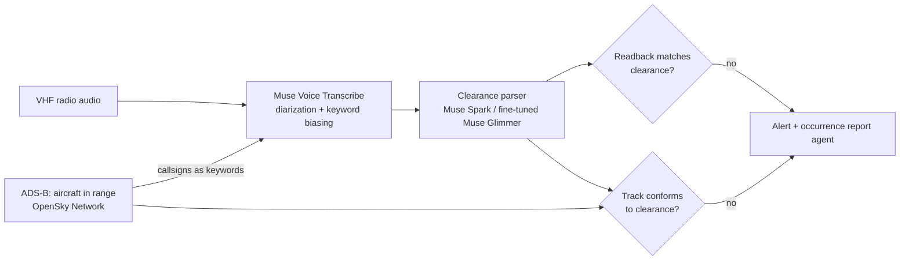

# Readback

A controller says "CSA1DZ, descend flight level one hundred". The pilot replies "descending flight level one one zero, CSA1DZ". Nobody notices. That missed **readback error** is a classic cause of altitude busts and loss of separation.

Readback listens to the radio frequency, works out what each aircraft was cleared to do, checks the pilot's readback against it, and then checks the aircraft's actual track (ADS-B) against the clearance. When something doesn't match it raises an alert with the audio clip and the flight track attached.

Built for the [Meta Global AI Developer Hackathon](https://cerebralvalley.ai/e/meta-ai-developer-hackathon) (Oct 26 – Nov 4, 2026), Indie track, "Push the Frontier" theme.

## How it works



- **Hearing the radio.** Muse Voice Transcribe separates controller and pilot turns, and its keyword biasing gets the callsigns of aircraft that ADS-B says are actually nearby. Callsigns are the hardest part of ATC speech to recognize and the most important to get right.
- **Understanding clearances.** Each turn becomes a structured clearance: callsign, instruction, altitude, heading, speed, frequency, runway, squawk.
- **Two checks.** The readback against the clearance, and the aircraft's ADS-B track against the clearance (for example, cleared to FL100 but still descending through it).
- **On-premises mode.** Air navigation providers can't send radio audio to a cloud service, so the parser also runs on Muse Glimmer (open weights).

## Status

| Date | Work |
|---|---|
| Oct 27 | Project scaffold. Voice Transcribe client, ATC text normalizer, recognition metrics, and the day-1 go/no-go test of Voice Transcribe on real ATC radio. |

Everything in this repository was written during the hackathon.

## Setup

Requires Python 3.12+ and [uv](https://docs.astral.sh/uv/).

```bash
uv sync
cp .env.example .env   # then add your Meta Model API key
uv run python scripts/fetch_data.py
```

## Day-1 go/no-go test

Before building anything on top, we measure how well Voice Transcribe hears real ATC radio, with and without callsign biasing:

```bash
uv run python scripts/spike_asr.py --dry-run   # checks the pipeline, no API calls
uv run python scripts/spike_asr.py             # 100 clips x 3 keyword conditions
```

The report goes to [`results/spike-asr.md`](results/spike-asr.md). It scores word error rate, digit error rate (altitudes, headings, frequencies) and callsign accuracy. Recognizer output and references are compared in a canonical form, so `CSA1DZ descend FL100` matches `csa one delta zulu descend flight level one hundred`.

## Tests

```bash
uv run pytest
uv run ruff check .
```

## Data and licenses

The evaluation audio is downloaded at run time and never committed. Only aggregate metrics are published.

- **ATCO2 test set (1 h)**: real VHF recordings from Czech airports, from the [ATCO2 project](https://www.atco2.org/data) (Zuluaga-Gomez et al., 2022, [arXiv:2211.04054](https://arxiv.org/abs/2211.04054)). Used under the ATCO2 end-user data agreement, via the [Hugging Face mirror](https://huggingface.co/datasets/Jzuluaga/atco2_corpus_1h).
- **UWB-ATCC**: University of West Bohemia ATC corpus ([LINDAT](https://lindat.mff.cuni.cz/repository/xmlui/handle/11858/00-097C-0000-0001-CCA1-0)), CC BY-NC-SA 4.0, via the [Hugging Face mirror](https://huggingface.co/datasets/Jzuluaga/uwb_atcc).

Code is MIT licensed. Readback is a research prototype, not a certified air traffic management tool.
