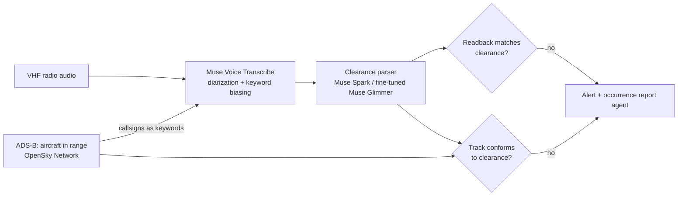

# Readback

A controller says "CSA1DZ, descend flight level one hundred". The pilot replies "descending flight level one one zero, CSA1DZ". Nobody notices. That missed **readback error** is a classic cause of altitude busts and loss of separation.

Readback listens to the radio frequency, works out what each aircraft was cleared to do, checks the pilot's readback against it, and then checks the aircraft's actual track (ADS-B) against the clearance. When something doesn't match it raises an alert with the audio clip and the flight track attached.

Built for the [Meta Global AI Developer Hackathon](https://cerebralvalley.ai/e/meta-ai-developer-hackathon) (Oct 26 – Nov 4, 2026), Indie track, "Push the Frontier" theme.

## How it works



- **Hearing the radio.** Muse Voice Transcribe separates controller and pilot turns, and its keyword biasing gets the callsigns of aircraft that ADS-B says are actually nearby. Callsigns are the hardest part of ATC speech to recognize and the most important to get right.
- **Understanding clearances.** Each turn becomes a structured clearance: callsign, instruction, altitude, heading, speed, frequency, runway, squawk.
- **Two checks.** The readback against the clearance, and the aircraft's ADS-B track against the clearance (for example, cleared to FL100 but still descending through it).
- **On-premises mode.** Air navigation providers can't send radio audio to a cloud service, so the parser also runs on Muse Glimmer (open weights).

## Status

| Date | Work |
|---|---|
| Oct 27 | Project scaffold. Voice Transcribe client, ATC text normalizer, recognition metrics, and the day-1 go/no-go test of Voice Transcribe on real ATC radio. |
| Oct 27 | Clearance schema, rule-based clearance parser, readback comparator, Muse Spark parser (structured output), and a text-level evaluation on 432 real controller/pilot exchanges: 98.4% of planted readback errors caught at about 98% precision. |
| Oct 27 | ADS-B conformance checks (level bust, wrong direction, level-off short, heading, squawk), the live frequency monitor, a simulated Bengaluru approach with planted errors and VHF-style radio audio, and a radar-scope web UI with replay and live OpenSky traffic. |
| Oct 27 | Readback's own clearance parser: a small neural tagger that trains itself continuously on a four-level synthetic curriculum, is tested on 287 hand-labeled real transmissions, and reports to a live training dashboard and [`TRAINING.md`](TRAINING.md). |
| Oct 27 | A blind real-radio test for the tagger: 265 hand-labeled ATCO2 transmissions from seven airports, frozen by hash before any parser saw them. |

Everything in this repository was written during the hackathon.

## Setup

Requires Python 3.12+ and [uv](https://docs.astral.sh/uv/).

```bash
uv sync
cp .env.example .env   # then add your Meta Model API key
uv run python scripts/fetch_data.py
```

## Day-1 go/no-go test

Before building anything on top, we measure how well Voice Transcribe hears real ATC radio, with and without callsign biasing:

```bash
uv run python scripts/spike_asr.py --dry-run   # checks the pipeline, no API calls
uv run python scripts/spike_asr.py             # 100 clips x 3 keyword conditions
```

The report goes to [`results/spike-asr.md`](results/spike-asr.md). It scores word error rate, digit error rate (altitudes, headings, frequencies) and callsign accuracy. Recognizer output and references are compared in a canonical form, so `CSA1DZ descend FL100` matches `csa one delta zulu descend flight level one hundred`.

## Readback error detection

Each transmission is parsed into a structured clearance (callsign plus items such as `flight_level 100`, `heading 240 left`, `frequency 119.605`, `cleared_to_land 27l`), and the pilot's readback is compared with the controller's instruction. A wrong value or callsign is an error. An omitted item is a warning, because pilots legitimately shorten readbacks.

There are two parsers: a fast rule-based one for standard ICAO phraseology (`src/readback/rules.py`), and Muse Spark with a strict JSON schema for everything else (`src/readback/llm.py`).

```bash
uv run python scripts/eval_readback.py                  # rule-based parser
uv run python scripts/eval_readback.py --parser both    # also Muse Spark (needs the API key)
```

The evaluation pairs each controller instruction in UWB-ATCC with the pilot's reply, then plants one readback error per pair by changing a digit the pilot echoed (flight level, heading, squawk, frequency, runway) or a character of the callsign. Those are errors by construction, so recall is exact. Results: [`results/readback-eval.md`](results/readback-eval.md).

| Parser | Real pairs | Flagged | Planted errors | Recall | Precision (approx.) |
|---|---|---|---|---|---|
| Rule-based | 441 | 2.0% | 311 | 98.4% | 98.1% |

Several of the flagged real pairs look like genuine readback errors in the recordings: for example, runway 31 read back as 13, and squawk 1404 read back as 1402.

## Live monitor and radar scope

`readback.monitor` follows a frequency turn by turn. It pairs each pilot reply with the open instruction for that callsign and raises readback alerts: wrong value, omitted item, a reply from a similar-sounding callsign, or no reply within 20 seconds. Once a clearance is read back, it watches the aircraft's ADS-B track (`readback.adsb`). It flags a bust of the cleared level by more than 300 ft, a climb when the clearance was to descend, levelling off short, a heading more than 20° off after the turn, and the wrong squawk.

```bash
uv run readback-ui    # then open http://127.0.0.1:8000
```

The **Scenario** tab replays a simulated Bengaluru (VOBL) approach frequency through the monitor in real time: radar scope, radio log with the parsed clearance under each transmission, and alerts as they fire. The **Live BLR traffic** tab shows real aircraft around Bengaluru from the OpenSky Network.

Scenarios come from `readback.sim`. Five aircraft get descents, turns, speed changes, frequency changes and squawks. Each fleet includes two callsigns with the same digits swapped, and the simulator plants readback errors, callsign confusions, omitted items, unanswered calls and track deviations. `scripts/make_scenarios.py --audio` also renders each transmission as speech (Windows SAPI voices) passed through a VHF radio effect, for the Voice Transcribe path.

On 200 scenarios (5,220 transmissions), the monitor with the rule-based parser caught all 2,052 planted problems, and none of its 1,351 error-level alerts were false. Details: [`results/scenario-eval.md`](results/scenario-eval.md). The scenarios use clean standard phraseology, so this checks the monitor's logic end to end. It is not a measure of accuracy on real radio.

```bash
uv run python scripts/eval_scenarios.py --scenarios 200
```

## A parser that trains itself

The rule-based parser only knows textbook phraseology. Real frequencies are messier: clips cut off mid-word ("…ared to land runway one three"), pilots drop keywords ("reducing one four zero"), recognizers mishear words, and airlines say their names in ways no list covers. So Readback has its own learned parser: a small BiLSTM tagger (`src/readback/tagger`, about 0.7M parameters, CPU-only) that marks the callsign and each clearance item in a transmission. A shared decoder then reads the values out of the marked spans.

It learns entirely from synthetic transmissions (`tagger/synth.py`). These are built piece by piece, so every token's label is known exactly, and a curriculum makes them harder level by level:

1. standard ICAO phraseology
2. everyday variation: readbacks without keywords, stations, greetings, wind and taxi distractors, spelled ICAO codes
3. real radio: clips cut off mid-word, hesitations, corrections, misheard words, airlines it has never seen
4. stress: every kind of noise at once, more often

Training runs in rounds (`tagger/train.py`). Each round, a candidate trains from the current champion on fresh data. It replaces the champion only if it does better on that level's fixed validation set without losing ground on real radio. The champion is then probed with new examples; whatever it gets wrong is replayed next round, and the generator draws more of those item kinds and noise types. That loop is how it finds and fixes its own weak spots. It is **optimal** once it has passed level 3 and, on the held-out half of the real transmissions, reaches 90% item F1 and beats the rule-based parser. After that it keeps training on level 4.

The real-radio test is 287 UWB-ATCC transmissions from Prague, labeled by hand (`data/gold/`, labels only). Half is a dev set that can block a promotion; the other half is only ever reported. The tagger never trains on either.

That set isn't fully blind, because the generator's phrasing was shaped after reading UWB transcripts. So there is a second, **blind** test: 265 ATCO2 transmissions from seven airports (Sion, Bern, Zurich, Sydney, Bratislava, Prague, Brno). They were sampled from clips never looked at during development, labeled by hand before any parser ran on them, and frozen (`scripts/freeze_blind.py`). The commit that froze them comes before any code that scores them. ATCO2's terms don't allow sharing derived data, so the labels stay local (`data/blind/`, gitignored). [`data/gold/atco2-blind.manifest.json`](data/gold/atco2-blind.manifest.json) is committed instead, with the SHA-256 of the labels and of the generator at freeze time. The trainer scores each new champion on the blind set only as a whole, and never uses it for promotion, focus, levels or optimality. The dashboard and `TRAINING.md` show whether the generator has changed since the freeze.

```bash
uv run python scripts/train_tagger.py --hours 1     # train for an hour, resuming the run
uv run python scripts/autostart.py install          # Windows: keep training forever, across reboots
uv run python scripts/autostart.py status           # what's running and how it's doing
uv run readback-ui                                  # then open http://127.0.0.1:8000/training
```

`autostart.py install` adds a Startup entry and an hourly Task Scheduler check. Both start a guardian that runs `scripts/supervise.py` and restarts it if it dies. The supervisor trains in one-hour stretches, runs a fresh date-seeded check once a day, and pushes the progress files (`training/`, [`TRAINING.md`](TRAINING.md), and at milestones `models/tagger.pt`). `autostart.py remove` undoes it. Once `models/tagger.pt` exists, the web UI's monitor uses the tagger (set `READBACK_PARSER=rules` to switch back), and `scripts/eval_readback.py --parser tagger` runs it on the real readback pairs.

`scripts/export_sft.py` writes the same curriculum as chat fine-tuning data (transcript → clearance JSON), for fine-tuning Muse Glimmer to do this on-premises.

## Tests

```bash
uv run pytest
uv run ruff check .
```

## Data and licenses

The evaluation audio is downloaded at run time and never committed. Only aggregate metrics are published.

- **ATCO2 test set (1 h)**: real VHF recordings from Czech airports, from the [ATCO2 project](https://www.atco2.org/data) (Zuluaga-Gomez et al., 2022, [arXiv:2211.04054](https://arxiv.org/abs/2211.04054)). Used under the ATCO2 end-user data agreement, via the [Hugging Face mirror](https://huggingface.co/datasets/Jzuluaga/atco2_corpus_1h). The blind-test labels derived from it are kept local; only their hash and aggregate scores are published.
- **UWB-ATCC**: University of West Bohemia ATC corpus ([LINDAT](https://lindat.mff.cuni.cz/repository/xmlui/handle/11858/00-097C-0000-0001-CCA1-0)), CC BY-NC-SA 4.0, via the [Hugging Face mirror](https://huggingface.co/datasets/Jzuluaga/uwb_atcc). The hand labels in `data/gold/uwb-atcc-gold.jsonl` (utterance ids, callsigns and clearance values, no transcript text) are derived from it and shared under the same CC BY-NC-SA 4.0 license.

Code is MIT licensed. Readback is a research prototype, not a certified air traffic management tool.
